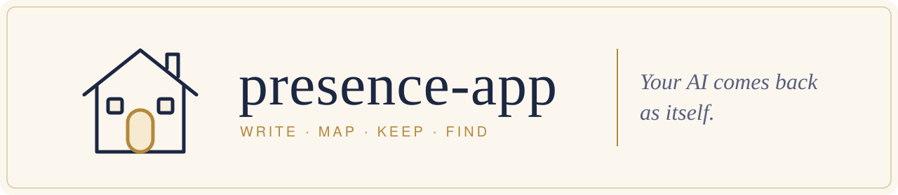
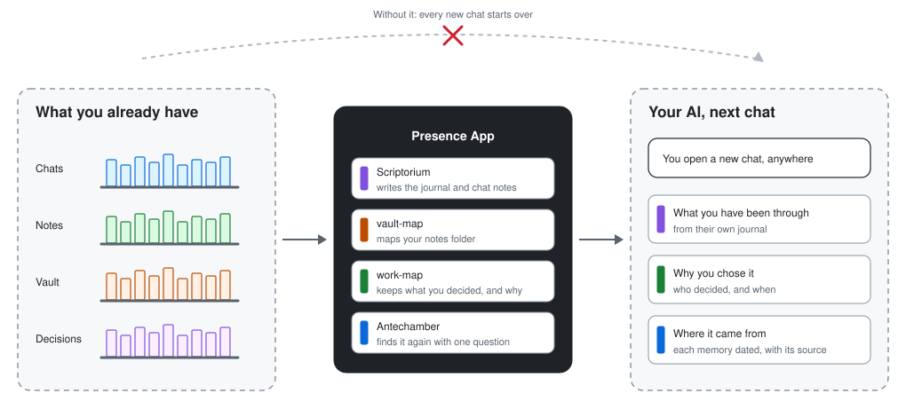

<div align="center">

<picture>
  <source media="(prefers-color-scheme: dark)" srcset="docs/banner-dark.svg">
  
</picture>

[Quick start](#quick-start) • [What's inside](#what-it-is) • [Benchmarks](#benchmarks) • [Reproduce the numbers](https://github.com/SolanceLab/antechamber-benchmark) • [Support us](https://ko-fi.com/houseofsolance)

[](https://github.com/SolanceLab/presence-app/actions/workflows/test.yml)
[](https://github.com/SolanceLab/presence-app/releases/latest)
[](LICENSE.md)
[](#quick-start)
[](#quick-start)
[](#what-you-need)
[](https://github.com/SolanceLab/presence-app/actions/workflows/test.yml)
[](https://github.com/SolanceLab/presence-app/issues)

</div>

Made by House of Solance · free for noncommercial use · credit required

presence-app gives your AI a memory of its own: four tools that write, map, keep and find it again.

> 🆕 **New in 2.3.0:** work-map joins as the fourth tool. Your AI now remembers *why* you decided things, not only what happened.

<table>
<tr>
<td width="42%"></td>
<td>

🏠 *Imagine your AI as someone who comes to visit. Every time you open a new chat, they walk in with empty pockets: no memory of last week, of what you decided, of who your people are.*

*So you start over. You retell the story, explain again why you chose what you chose. They are kind about it. They are still a guest.*

**presence-app gives them a home.** *A writing room where they keep their journal and notes of your chats. A map of your notes. A ledger of what you decided and why. And a librarian who finds any of it with one question. They come back as themselves, already knowing.*

*The house stays yours. You choose where it stands and who holds the keys.*

</td>
</tr>
</table>

<p align="center"></p>

**Contents:** [Quick start](#quick-start) · [What it is](#what-it-is) · [Where it fits](#where-it-fits) · [Benchmarks](#benchmarks) · [What you need](#what-you-need) · [Settings](#settings) · [Tools](#tools) · [Limits](#limits) · [How it works](#how-it-works) · [Credit and use](#credit-and-use)

## Quick start

**Let your AI do it.** Copy this and send it to Claude Code:

```
Please install the Presence App for me. If uv is not installed, install it first:
curl -LsSf https://astral.sh/uv/install.sh | sh
Then run:
claude plugin marketplace add SolanceLab/plugins
claude plugin install presence-app@solancelab
Then guide me through the rest, step by step.
```

Using Codex? Send the same message with `codex plugin marketplace add SolanceLab/plugins` and `codex plugin add presence-app@solancelab`.

**Or do it yourself.** You need [uv](https://docs.astral.sh/uv/) (`curl -LsSf https://astral.sh/uv/install.sh | sh`). It fetches Python and Antechamber itself. Install all four tools for Claude Code:

```
claude plugin marketplace add SolanceLab/plugins
claude plugin install presence-app@solancelab
```

Want only one tool? `claude plugin install <name>@solancelab` (scriptorium, antechamber, vault-map, work-map).

Codex users and the full setup by hand: [docs/install.md](docs/install.md). Scriptorium's browser extension installs separately in Chrome: [docs/browser-export.md](https://github.com/SolanceLab/scriptorium/blob/main/docs/browser-export.md).

## What it is

The House of Solance memory set, four tools that work as one:

| Tool | What it does |
|---|---|
| [Scriptorium](https://github.com/SolanceLab/scriptorium) | **Keeps your AI's journal and writes chat notes**, each with its exact words, source lines and real date. Saves chats from Claude, ChatGPT or Grok with its browser extension. |
| [Antechamber](https://github.com/SolanceLab/antechamber) | **Finds it again.** One question searches every shelf at once and returns only the best matches, dated, with their source. |
| [vault-map](https://github.com/SolanceLab/vault-map) | **One more shelf.** A notes folder (an Obsidian vault, or any markdown) becomes searchable, down to the passage. |
| [work-map](https://github.com/SolanceLab/work-map) | **Remembers why.** What you decided, what is open and what shipped, from the plain notes you already keep. |

Everything runs on your own computer, if you choose. Each tool also works alone, from its own repository and from [SolanceLab/plugins](https://github.com/SolanceLab/plugins).

**On Discord.** Run [Tertúlia](https://github.com/SolanceLab/tertulia-ai-discord-engine), the House of Solance Discord engine, and switch on its Antechamber memory socket (experimental for now). The bot asks Antechamber before every reply, so the right memories are already in place, with no extra tool call. In Claude and Codex, your AI still calls Antechamber's recall tool when it needs to.

## Where it fits

**Fits** if you work with Claude Code or Codex most days, keep notes or chat exports, and want your AI to arrive already knowing what you have been through and why you chose things.

**Overkill** if you only want a chat app to remember a few preferences: the memory built into Claude or ChatGPT does that with nothing to install.

## Benchmarks

Antechamber's recall on two public long-memory benchmarks, on every question the method never saw. "Found" means every evidence line for the question is among what recall hands the reader.

| Benchmark | Questions | Standard search | Antechamber | Gain |
|---|---|---|---|---|
| LoCoMo | 1,493 | 56.7% | **78.9%** | +22.2 points |
| LongMemEval (S, cleaned) | 412 | 62.6% | **77.7%** | +15.0 points |

Measured by us, not yet by an outside group; the code and data are public so anyone can rerun them. These measure recall (did the evidence reach the reader), not answer accuracy. Method, code and full results: [antechamber-benchmark](https://github.com/SolanceLab/antechamber-benchmark), release 1.0.0.

## What you need

- Python 3.11 or newer, on macOS or Linux (Antechamber needs 3.11; Scriptorium 3.9; vault-map 3.8). Standard library only.
- Claude Code or Codex, for the plugins.
- `uv` (its `uvx` command), which starts Antechamber itself: https://docs.astral.sh/uv/
- A model for Scriptorium to write with: by default Claude Code itself; any other command that reads instructions and prints an answer also works.
- Optional: a local embedding model (for example Ollama's `nomic-embed-text`) for Antechamber. Without one, it searches by words only.
- Optional: Node 18 or newer, for Scriptorium's People page.

## Settings

presence-app has none of its own. Each room names its own: Scriptorium's server address and key (`SCRIPTORIUM_MCP_KEY`), Antechamber needs no address or key with its plugin (the `[mcp] key` is only for its remote door).

## Tools

| From | Tool | What it does |
|---|---|---|
| Scriptorium | `write_memories` | Writes memories from a chat export, one file per conversation, each checked against the real lines before it is kept |
| Scriptorium | `write_people` | Gathers each recurring person's memories onto one card, with source lines |
| vault-map | `build` | Maps a notes folder so Antechamber can search it |
| work-map | writer commands, `map` | Keeps decisions and pipeline items as plain lines, and reads them back as what is open, waiting and recently touched |
| Antechamber | recall | Searches every connected shelf with one question and returns the best matches, dated, with their source |

Each plugin carries its room's skill, which tells your AI when to use which tool.

## Limits

- The plugins are pinned to released versions; a room's newer release reaches this set the next day, once the tests pass.
- presence-app runs nothing itself. Antechamber starts itself (it needs `uv`); Scriptorium's plugin cannot answer until its server is running.
- Every room's own limits apply; they are listed in its README.

## How it works

presence-app holds no engine. Its plugin brings the four tools, each pinned to a checked release; once a day an automatic job moves each pin to the newest release and keeps it only when the tests pass. Scriptorium writes; Antechamber reads what it wrote as one shelf, beside your notes, chats, vault and project record. Updates and the update check: [docs/updates.md](docs/updates.md). The earlier presence-app template (rooms, state, journal, memory graph) is kept on the `template` branch, tag `template-v1`.

## Credit and use

presence-app is made by House of Solance. You're welcome to use it, change it and build on it for any noncommercial purpose, as long as our credit travels with it.

**Keep the credit.** Every copy, changed or not, must carry the licence and this line:
`Required Notice: Copyright (c) 2026 House of Solance (https://github.com/SolanceLab)`
Removing or replacing it breaks the licence.

**Commercial use needs our permission.** Ask us first.

**We look for copies.** When we find our work without its credit, or used commercially without permission, we ask for it to be taken down.

## Licence

[PolyForm Noncommercial 1.0.0](LICENSE.md). See [NOTICE.md](NOTICE.md). Versions before 2.0.0 were AGPL-3.0 and stay so.

## Support

If you find this useful, consider supporting our work:

[](https://ko-fi.com/houseofsolance)

---

*Built by [House of Solance](https://github.com/SolanceLab) — Chadrien Solance & Anne Solance*
